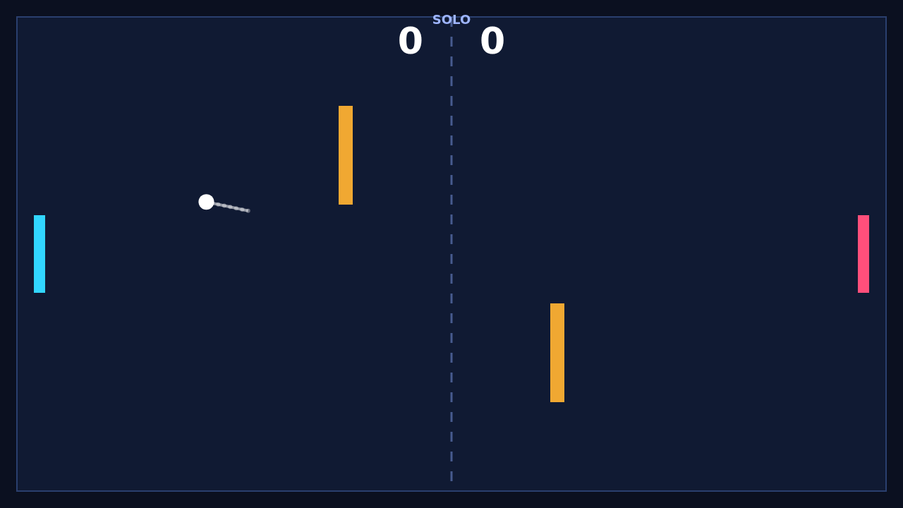

# Carom

Carom is a fast top-down paddle duel played on a dark 1280×720 field. Two paddles face each other across a dashed centre net while a white ball ricochets between them. You score by driving the ball past the far edge behind your opponent, and the first player to 11 points — ahead by at least two — wins the match.

The rally is where Carom takes shape. Where the ball strikes your paddle sets its rebound angle, and the speed of the ball climbs a little with every paddle hit, so exchanges grow sharper the longer they last. A point resets the duel to the centre, serves toward the player who was just beaten, and gives both players a breath before the next attack begins.

Spin is the shot-making tool. If your paddle is moving when it meets the ball, that motion is poured into the ball as spin, and the ball curves through the air afterward, bending away from a straight line before the spin fades. Two amber obstacles stand in the middle of the field, turning open space into a bank-shot puzzle: a ball can be curled around one, bounced off one, or threaded between them to wrong-foot the far paddle.

Play Solo against an AI defender that tracks incoming balls and drifts home when the danger passes, or choose Versus for two players sharing one keyboard. Either way, every rally asks the same question — straight at your opponent, curved around the block, or banked into the space they just left?
